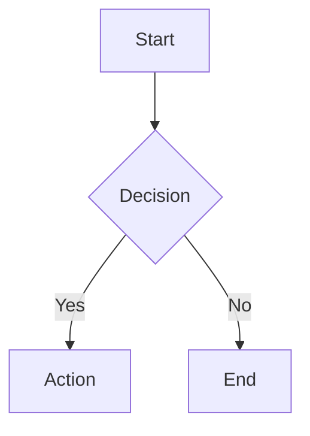

# 📝 Online Markdown Viewer

A powerful, feature-rich online Markdown viewer with real-time preview, built with React and Vite.


## ✨ Features

### Core Features
- 📝 **Live Preview** - Real-time markdown rendering as you type
- 🎨 **Monaco Editor** - Professional code editor (same as VS Code)
- 🌓 **Dark Mode** - Beautiful light and dark themes
- 💾 **Auto-Save** - Automatic localStorage persistence
- 📊 **Status Bar** - Word count, character count, and line count

### Markdown Support
- ✅ **GitHub Flavored Markdown (GFM)** - Full GFM support
- 📋 **Task Lists** - Interactive checkboxes
- 📊 **Tables** - Beautiful table rendering
- 😀 **Emojis** - Full emoji support
- 🔗 **Auto-linking** - Automatic URL detection

### Advanced Features
- 📈 **Mermaid Diagrams** - Flowcharts, sequence diagrams, and more
- 🧮 **LaTeX Math** - Inline and block math formulas with KaTeX
- 🎯 **Syntax Highlighting** - Code blocks with language support
- 🔒 **XSS Protection** - DOMPurify sanitization for security

### File Operations
- 📁 **File Upload** - Upload .md files
- 🖱️ **Drag & Drop** - Drag and drop markdown files
- 📄 **Export to HTML** - Download as styled HTML
- 📑 **Export to PDF** - Generate PDF documents
- 📋 **Copy HTML** - Copy rendered HTML to clipboard

### UI/UX
- 🎨 **Premium Design** - Modern, glassmorphism effects
- 📱 **Responsive** - Split-pane layout
- 🔤 **Font Size Control** - Adjustable text size
- ⚡ **Fast Performance** - Optimized rendering with debouncing

## 🚀 Quick Start

### Prerequisites
- Node.js 18+ 
- npm or yarn

### Installation

1. **Clone or navigate to the project:**
   ```bash
   cd MdViewer
   ```

2. **Install dependencies:**
   ```bash
   npm install
   ```

3. **Install Tailwind typography plugin:**
   ```bash
   npm install -D @tailwindcss/typography
   ```

4. **Start development server:**
   ```bash
   npm run dev
   ```

5. **Open in browser:**
   Navigate to `http://localhost:5173/`

## 📦 Tech Stack

### Frontend Framework
- **React 19.2** - UI library
- **Vite 7.2** - Build tool and dev server

### Editor & Rendering
- **Monaco Editor** - Code editor component
- **markdown-it** - Markdown parser
- **Mermaid** - Diagram rendering
- **KaTeX** - Math typesetting

### Styling
- **Tailwind CSS 3.4** - Utility-first CSS framework
- **@tailwindcss/typography** - Prose styling
- **Custom Design System** - Premium color palette and animations

### Security & Export
- **DOMPurify** - XSS sanitization
- **html2pdf.js** - PDF generation

## 🎯 Usage

### Basic Editing
1. Type markdown in the left editor panel
2. See live preview on the right panel
3. Content auto-saves to localStorage

### Theme Toggle
- Click the 🌙/☀️ icon in the toolbar to switch themes

### Font Size
- Use **A-** and **A+** buttons to adjust text size

### File Operations
- **Upload**: Click 📁 Upload button or drag & drop .md files
- **Export HTML**: Click 📄 HTML button
- **Export PDF**: Click 📑 PDF button
- **Copy HTML**: Click 📋 Copy button

### Markdown Examples

#### Task Lists
```markdown
- [x] Completed task
- [ ] Pending task
```

#### Tables
```markdown
| Feature | Status |
|---------|--------|
| Editor  | ✅     |
| Preview | ✅     |
```

#### Math (LaTeX)
```markdown
Inline: $E = mc^2$

Block:
$$
\int_{-\infty}^{\infty} e^{-x^2} dx = \sqrt{\pi}
$$
```

#### Mermaid Diagrams
````markdown

````

## 📁 Project Structure

```
MdViewer/
├── src/
│   ├── components/
│   │   ├── Editor.jsx          # Monaco editor wrapper
│   │   ├── Preview.jsx         # Markdown preview renderer
│   │   ├── Toolbar.jsx         # Top toolbar with controls
│   │   └── StatusBar.jsx       # Bottom status bar
│   ├── utils/
│   │   ├── markdownParser.js   # Markdown parsing & sanitization
│   │   ├── exportUtils.js      # Export functionality
│   │   └── storageUtils.js     # localStorage operations
│   ├── App.jsx                 # Main application component
│   ├── main.jsx                # Entry point
│   └── index.css               # Global styles & Tailwind
├── public/                     # Static assets
├── index.html                  # HTML template
├── vite.config.js              # Vite configuration
├── tailwind.config.js          # Tailwind configuration
├── postcss.config.js           # PostCSS configuration
└── package.json                # Dependencies
```

## 🛠️ Development

### Available Scripts

```bash
# Start development server
npm run dev

# Build for production
npm run build

# Preview production build
npm run preview

# Run linter
npm run lint
```

### Build Optimization
- Code splitting for Monaco Editor, Markdown libraries, and vendor code
- Lazy loading for Mermaid diagrams
- Debounced rendering for performance

## 🔒 Security

- **XSS Protection**: All HTML is sanitized with DOMPurify
- **No Raw HTML**: HTML in markdown is disabled by default
- **Safe Links**: External links open in new tabs with `noopener noreferrer`

## 🎨 Customization

### Theme Colors
Edit `tailwind.config.js` to customize the color palette:
```javascript
colors: {
  primary: { /* your colors */ },
  dark: { /* your colors */ }
}
```

### Font Family
Change fonts in `tailwind.config.js`:
```javascript
fontFamily: {
  sans: ['Your Font', 'system-ui'],
  mono: ['Your Mono Font', 'monospace'],
}
```

## 📝 License

This project is open source and available for personal and commercial use.

## 🤝 Contributing

Contributions, issues, and feature requests are welcome!

## 📧 Support

For support, please open an issue in the repository.

---

**Built with ❤️ using React, Vite, and Tailwind CSS**
