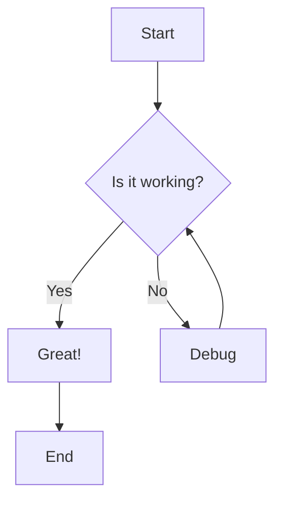
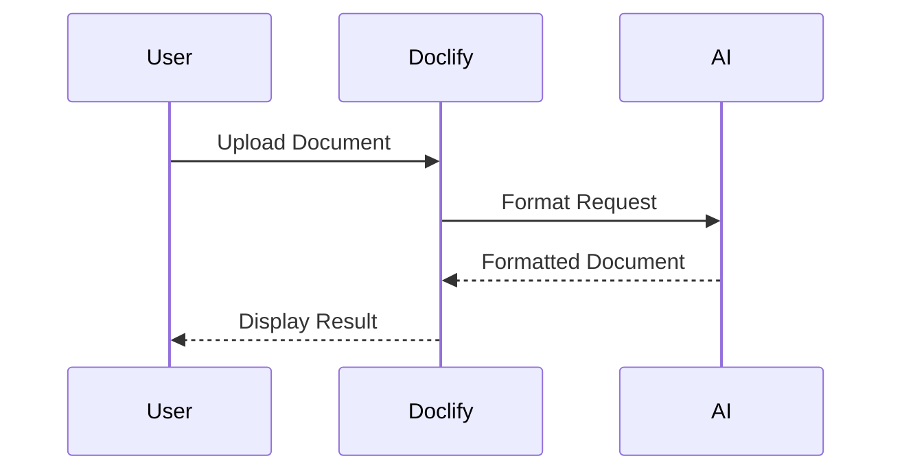

# Doclify Test Samples

This document contains test samples for all three formats supported by Doclify.

---

## 📝 MARKDOWN TEST SAMPLE

Copy and paste this into the Markdown editor:

```markdown
# Welcome to Doclify! 🚀

## Features Overview

Doclify is a **powerful** multi-format document viewer with *AI capabilities*.

### Text Formatting

- **Bold text** for emphasis
- *Italic text* for subtle highlights
- ~~Strikethrough~~ for corrections
- `Inline code` for commands

### Lists

#### Unordered List
- First item
- Second item
  - Nested item 1
  - Nested item 2
- Third item

#### Ordered List
1. Introduction
2. Main Content
   1. Subsection A
   2. Subsection B
3. Conclusion

#### Task List
- [x] Completed task
- [ ] Pending task
- [ ] Future task

### Code Blocks

#### JavaScript Example
```javascript
function greet(name) {
  console.log(`Hello, ${name}!`);
  return `Welcome to Doclify`;
}

greet('Developer');
```

#### Python Example
```python
def calculate_sum(a, b):
    """Calculate the sum of two numbers"""
    return a + b

result = calculate_sum(10, 20)
print(f"Result: {result}")
```

### Tables

| Feature | Markdown | HTML | JSON |
|---------|----------|------|------|
| Syntax Highlighting | ✅ | ✅ | ✅ |
| Preview | ✅ | ✅ | ✅ |
| Export | ✅ | ✅ | ✅ |
| AI Format | ✅ | ✅ | ✅ |

### Links and Images

Visit [Doclify Documentation](https://github.com) for more information.


### Blockquotes

> "The best way to predict the future is to create it."
> — *Abraham Lincoln*

### Horizontal Rule

---

### Math Equations (KaTeX)

Inline math: $E = mc^2$

Block math:
$$
\int_{0}^{\infty} e^{-x^2} dx = \frac{\sqrt{\pi}}{2}
$$

### Mermaid Diagrams





### Emoji Support 🎉

🚀 Rocket | 📝 Document | 💡 Idea | ✨ Magic | 🎨 Design

---

**Thank you for using Doclify!** 💙
```

---

## 🌐 HTML TEST SAMPLE

Copy and paste this into the HTML editor:

```html
<!DOCTYPE html>
<html lang="en">
<head>
    <meta charset="UTF-8">
    <title>Doclify HTML Demo</title>
    <style>
        body {
            font-family: 'Poppins', sans-serif;
            max-width: 800px;
            margin: 0 auto;
            padding: 2rem;
            background: linear-gradient(135deg, #667eea 0%, #764ba2 100%);
            color: white;
        }
        .card {
            background: rgba(255, 255, 255, 0.1);
            backdrop-filter: blur(10px);
            border-radius: 16px;
            padding: 2rem;
            margin: 1rem 0;
            border: 1px solid rgba(255, 255, 255, 0.2);
        }
        h1 {
            font-size: 2.5rem;
            margin-bottom: 1rem;
            text-shadow: 2px 2px 4px rgba(0,0,0,0.3);
        }
        .button {
            background: white;
            color: #667eea;
            padding: 0.75rem 1.5rem;
            border-radius: 8px;
            text-decoration: none;
            display: inline-block;
            margin: 0.5rem 0;
            font-weight: 600;
            transition: transform 0.2s;
        }
        .button:hover {
            transform: scale(1.05);
        }
        table {
            width: 100%;
            border-collapse: collapse;
            margin: 1rem 0;
        }
        th, td {
            padding: 0.75rem;
            text-align: left;
            border-bottom: 1px solid rgba(255, 255, 255, 0.2);
        }
        th {
            background: rgba(255, 255, 255, 0.1);
            font-weight: 600;
        }
    </style>
</head>
<body>
    <div class="card">
        <h1>🎨 Welcome to Doclify HTML Preview</h1>
        <p>This is a demonstration of the <strong>HTML rendering capabilities</strong> with beautiful styling!</p>
    </div>

    <div class="card">
        <h2>✨ Features</h2>
        <ul>
            <li>Syntax highlighting for HTML code</li>
            <li>Live preview of rendered output</li>
            <li>Sanitized and secure rendering</li>
            <li>Support for custom styles</li>
        </ul>
    </div>

    <div class="card">
        <h3>📊 Data Table</h3>
        <table>
            <thead>
                <tr>
                    <th>Format</th>
                    <th>Status</th>
                    <th>Features</th>
                </tr>
            </thead>
            <tbody>
                <tr>
                    <td>Markdown</td>
                    <td>✅ Active</td>
                    <td>Mermaid, KaTeX, GFM</td>
                </tr>
                <tr>
                    <td>HTML</td>
                    <td>✅ Active</td>
                    <td>Dual Preview, Styling</td>
                </tr>
                <tr>
                    <td>JSON</td>
                    <td>✅ Active</td>
                    <td>Syntax Highlight, Stats</td>
                </tr>
            </tbody>
        </table>
    </div>

    <div class="card">
        <h3>🔗 Interactive Elements</h3>
        <a href="#" class="button">Click Me!</a>
        <a href="#" class="button">Learn More</a>
    </div>

    <div class="card">
        <h3>📝 Form Example</h3>
        <form>
            <label for="name">Name:</label>
            <input type="text" id="name" placeholder="Enter your name" style="padding: 0.5rem; border-radius: 4px; margin: 0.5rem 0; width: 100%;">
            <br>
            <button type="button" class="button">Submit</button>
        </form>
    </div>

    <div class="card">
        <blockquote style="border-left: 4px solid white; padding-left: 1rem; font-style: italic;">
            "Design is not just what it looks like and feels like. Design is how it works."
            <br>— Steve Jobs
        </blockquote>
    </div>
</body>
</html>
```

---

## 📋 JSON TEST SAMPLES

### ✅ Valid JSON Sample 1 (Simple Object)

```json
{
  "app": "Doclify",
  "version": "1.0.0",
  "description": "Multi-format document viewer",
  "features": {
    "markdown": true,
    "html": true,
    "json": true,
    "ai": true
  },
  "pricing": {
    "free": true,
    "premium": false,
    "price": 0
  },
  "tags": ["viewer", "editor", "ai", "markdown", "html", "json"],
  "contact": null
}
```

### ✅ Valid JSON Sample 2 (Nested Array)

```json
{
  "users": [
    {
      "id": 1,
      "name": "Alice Johnson",
      "email": "alice@example.com",
      "role": "admin",
      "active": true,
      "projects": ["Doclify", "WebApp", "MobileApp"]
    },
    {
      "id": 2,
      "name": "Bob Smith",
      "email": "bob@example.com",
      "role": "developer",
      "active": true,
      "projects": ["Doclify", "API"]
    },
    {
      "id": 3,
      "name": "Carol Williams",
      "email": "carol@example.com",
      "role": "designer",
      "active": false,
      "projects": []
    }
  ],
  "totalUsers": 3,
  "lastUpdated": "2026-02-04T15:52:00Z"
}
```

### ✅ Valid JSON Sample 3 (Complex Nested)

```json
{
  "company": {
    "name": "Tech Innovations Inc.",
    "founded": 2020,
    "headquarters": {
      "city": "San Francisco",
      "state": "CA",
      "country": "USA",
      "coordinates": {
        "latitude": 37.7749,
        "longitude": -122.4194
      }
    },
    "departments": [
      {
        "name": "Engineering",
        "headCount": 50,
        "teams": [
          {
            "name": "Frontend",
            "members": 15,
            "technologies": ["React", "Vue", "TypeScript"]
          },
          {
            "name": "Backend",
            "members": 20,
            "technologies": ["Node.js", "Python", "Go"]
          }
        ]
      },
      {
        "name": "Design",
        "headCount": 10,
        "teams": [
          {
            "name": "UI/UX",
            "members": 10,
            "technologies": ["Figma", "Adobe XD", "Sketch"]
          }
        ]
      }
    ],
    "revenue": 5000000.50,
    "public": false
  }
}
```

### ❌ Invalid JSON Sample 1 (Missing Quote)

```json
{
  "name": "Test,
  "value": 123
}
```

### ❌ Invalid JSON Sample 2 (Trailing Comma)

```json
{
  "item1": "value1",
  "item2": "value2",
}
```

### ❌ Invalid JSON Sample 3 (Single Quotes)

```json
{
  'name': 'Invalid',
  'error': true
}
```

### ❌ Invalid JSON Sample 4 (Unquoted Key)

```json
{
  name: "Missing quotes",
  value: 100
}
```

---

## 🧪 Quick Test Instructions

### For Markdown:
1. Click on "Markdown" tab
2. Paste the Markdown sample
3. Check: Headings, tables, code blocks, mermaid diagrams, math equations
4. Try AI "Convert" button (requires API key)
5. Test Export HTML and Export PDF

### For HTML:
1. Click on "HTML" tab
2. Paste the HTML sample
3. Check: Syntax highlighting in code view
4. Check: Rendered preview below
5. Try "Format HTML" button
6. Test Export functions

### For JSON:
1. Click on "JSON" tab
2. Paste **Valid JSON Sample 1** first
3. Check: Syntax highlighting (blue keys, green strings, orange numbers)
4. Check: Stats display (lines, keys, ✓ Valid badge)
5. Try "Format JSON" button
6. Paste an **Invalid JSON** sample to see error display
7. Check: Error message, suggestions, helpful tips

---

## ✨ Expected Results

### Markdown:
- All formatting renders correctly
- Mermaid diagrams display as flowcharts
- Math equations render with KaTeX
- Tables are properly formatted
- Code has syntax highlighting

### HTML:
- Top section shows formatted HTML code with syntax colors
- Bottom section shows the actual rendered webpage
- Toolbars separate the sections
- Gradient glass effects visible

### JSON:
- Valid JSON shows pretty-printed with colors
- Stats show correct line/key counts
- Invalid JSON shows helpful error messages
- Suggestions appear for common mistakes

---

**Happy Testing! 🎉**
